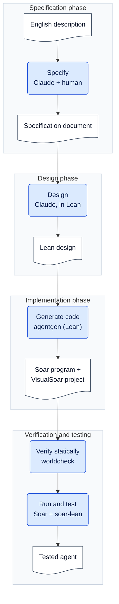
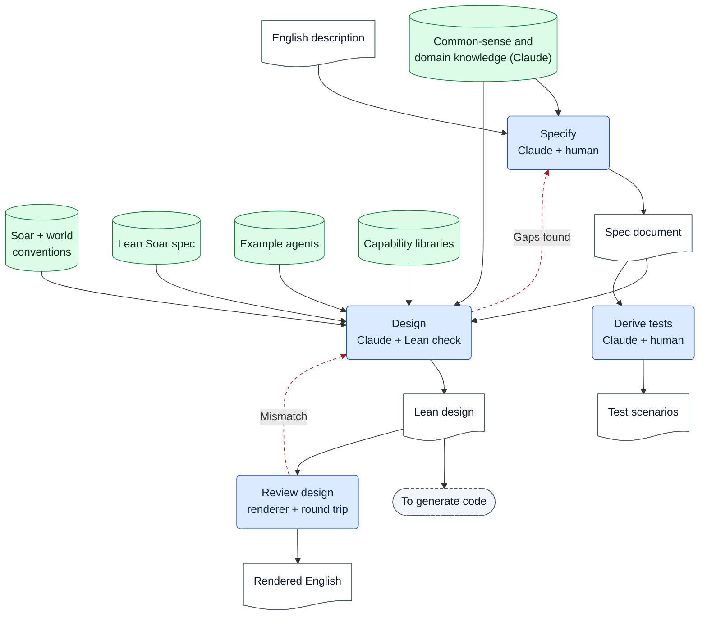
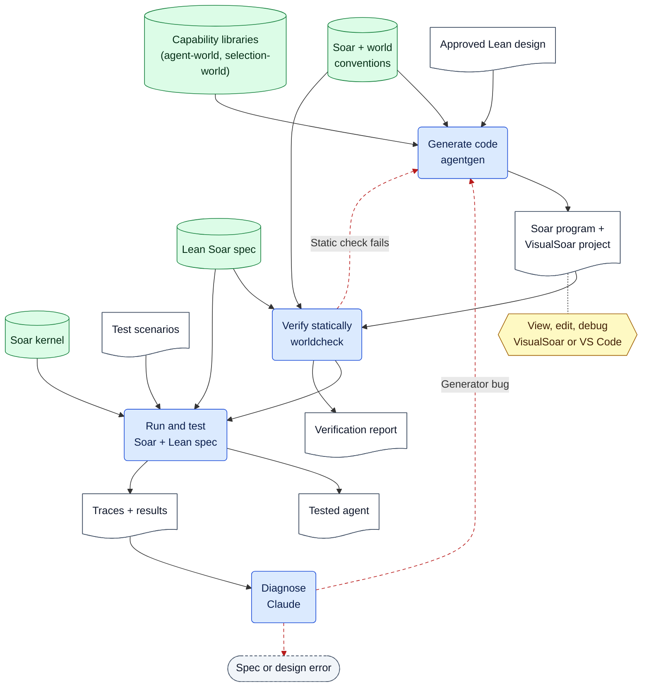
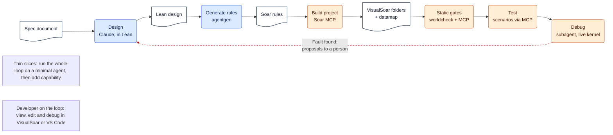

# From English to a Tested Soar Agent: Pipeline Data Flow

Mermaid source for the pipeline diagrams, converted from `soar-pipeline-dataflow.pptx` (slides 2, 3, 4 and 12).
Edit the code blocks below; GitHub renders them directly.

**Conventions (the legend)**

| Shape | Meaning |
|---|---|
| Rounded box (blue) | Process |
| Document shape (white) | Data or artifact |
| Cylinder (green) | Knowledge source |
| Dashed arrow (red) | Feedback |
| Solid thin arrow from a cylinder | Knowledge feeds a process |

Node IDs are stable (`P_` process, `D_` data, `K_` knowledge); keep them when renaming labels so diffs stay readable.

---

## 1. The main path: five processes, five artifacts

Forward path only. The implementation process is code generation: a deterministic program (agentgen), not Claude, because its input is a formal Lean design.

---

## 2. Data flow 1: English to an approved Lean design

Specify turns the English into a clause-numbered, mostly human-readable spec. Tests are derived from the spec before any design exists. Design review renders the Lean design back to English and checks it by round trip.

---

## 3. Data flow 2: Lean design to a tested Soar agent

Generate code is agentgen: the Lean generator runs (compile) with no LLM and produces Soar rules and the VisualSoar project (rule files, datamap, provenance doc strings), linking in capability libraries.

---

## 4. Proposal: a revised flow that uses the Soar MCP server tools

Changes from flows 2 and 3, using ideas from Wray, Schmidt & Jones (2026). Orange boxes are the new processes. If agentgen already writes the datamap, the MCP role reduces to validation. Faults go back to a person as proposals, not automatic fixes.

